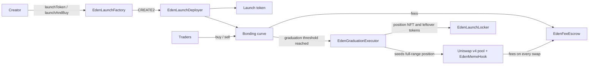

# Eden Contracts

Smart contracts for [Eden](https://edenfamily.xyz), the launchpad on Elysium that takes memes from launch to perpetuals.

Every token on Eden starts on a bonding curve. Once enough HYPE has been bought into the curve, the token graduates into a Uniswap v4 pool whose liquidity is locked forever. Nobody can withdraw it, the Eden team included.

## Deployment: Elysium mainnet

Chain ID `99901`. Native gas and quote asset: HYPE. Deployed from block `2277954`.

| Contract | Address |
|---|---|
| EdenLaunchFactory | `0x7260894d5f782844a60ec3689c001cd8ac65f4b1` |
| EdenMemeHook (Uniswap v4 hook) | `0x6132342bDdd14e6A0d1cbCAA3a7b6299AC2D2044` |
| EdenFeeEscrow | `0xc66b848a79676b39c0e51f3d6e43596beab868e9` |
| EdenLaunchLocker | `0x9baa4bd69cb93f01e1b4a4632bd7a882bbab989f` |
| EdenBuybackVault | `0x5b734cb2412e3ed5acca8869719593642c20b833` |
| EdenGraduationExecutor | `0xfc3754655e2622a4c396c0d9868c193f4c636d3a` |
| EdenGraduationGuard | `0x3d0EF994C5478B253a3BdBDD4E7a6f84bFe101E4` |
| EdenLaunchDeployer | `0xa36163be33e7795387c7e40c0a9505e27072aa1a` |
| EdenLaunchAndBuy | `0x50f7cd75af1e8f98649e5fa12ecddc3a4f240f4c` |

Uniswap v4 on Elysium: PoolManager `0xE2e105d3F7209A9DA11f83cCf3E7398a753823F1`, PositionManager `0x1d1C51b9d07fD27d36412A2b66CC23D19Eb3E518`, Permit2 `0x000000000022D473030F116dDEE9F6B43aC78BA3`.

The machine-readable record is in [`deployments/elysium-mainnet.json`](deployments/elysium-mainnet.json).

## How a launch works



1. **Launch.** The factory deploys a token (1,000,000,000 supply) and its bonding curve at addresses derived from the creator and a salt. A creator can launch and make the first buy in one transaction through `EdenLaunchAndBuy`.
2. **Curve.** Trading starts at once against a constant-product curve with a virtual (phantom) HYPE reserve that sets the starting price. Buys in the first seconds pay an anti-snipe tax that decays to zero; the creator and up to 32 declared wallets are exempt.
3. **Graduation.** When the curve's real HYPE reaches the graduation threshold, the reserve and the remaining tokens seed a full-range Uniswap v4 position at the curve's final price. The position NFT and any tokens that do not fit at that price go to `EdenLaunchLocker`, which has no function to release them.
4. **Pool.** The pool's LP fee is zero. `EdenMemeHook` charges the trading fee on every swap and routes it to the creator and the protocol through `EdenFeeEscrow`.

## Parameters at deployment

| Setting | Value |
|---|---|
| Supply per token | 1,000,000,000 |
| Launch fee | 0.0005 HYPE, paid to the protocol fee recipient |
| Trading fee | 1% |
| Creator / protocol split | 70% / 30% |
| Launch config 0: phantom reserve | 76.0483 HYPE |
| Launch config 0: graduation threshold | 190.12075 HYPE (about $72k FDV at graduation at deploy-time prices) |
| Share of supply sold on the curve | 71.4% |
| Anti-snipe tax | starts at 99%, decays to 0 over 15 seconds |
| Public launches | closed at deployment; whitelisted launchers only |

Each launch snapshots its economics when it is created. Later changes by the owner apply to new launches only.

## What the owner can and cannot do

The factory, hook, locker, buyback vault and launch router are owned through OpenZeppelin `Ownable2Step`, so a transfer only completes when the new owner accepts it. The factory, hook, locker and vault also cannot be renounced. The fee escrow, launch deployer and graduation executor have no owner.

The owner **can**:

- open or close public launches and whitelist launchers (`setLaunchEnabled`, `setWhitelistedLauncher`)
- add or update launch configs and the launch fee (`addLaunchConfig`, `updateLaunchConfig`, `setLaunchFee`)
- tune the anti-snipe tax and the maximum creator tax
- set the hook's fee policy for future launches (`setProtocolFeeShareBps`, `setHookFeeBps`, `setBuybackBurnBps`)
- propose a new creator fee recipient for a launch. This waits a 3-day timelock and must then be executed within 3 days (`setCreatorFeeRecipient`)
- release the reserves of a launch that finished its curve but could not be seeded into Uniswap, only after 7 days (`rescueSweptGraduation`)

The owner **cannot**:

- withdraw or move liquidity from a graduated pool
- change the economics of a token that has already launched
- move a creator's fee recipient without the public timelock

## Repository layout

```
src/
  EdenLaunchFactory/       factory: launch configs, launches, graduation, fee policy snapshots
  EdenLaunchDeployer/      deploys each token + bonding curve pair (CREATE2)
  EdenMemeHook/            Uniswap v4 hook shared by every graduated pool
  EdenFeeEscrow/           holds earned fees until each recipient claims them
  EdenLaunchLocker/        permanent home of graduated LP positions and leftover tokens
  EdenBuybackVault/        optional buyback-and-lock from creator fees
  EdenGraduationExecutor/  seeds the Uniswap v4 position at graduation
  EdenLaunchAndBuy/        atomic launch + first buy router
deployments/
  elysium-mainnet.json
```

Each folder holds the exact sources that deployed contract was compiled from, which is why some files (shared interfaces, libraries) appear in several folders.

## Build settings

- Solidity `0.8.35`, `viaIR: true`, optimizer enabled with 200 runs, EVM version `cancun`
- Dependencies: OpenZeppelin Contracts, Uniswap `v4-core`, `v4-periphery`, `v4-hooks-public`, and Permit2

## Origin and license

Eden's contracts are derived from Pons V2, which is published under the MIT license. Eden renamed and redeployed them on Elysium. Code comments still refer to "pons v2" where they describe the original design.

This repository is released under the [MIT license](LICENSE). Third-party dependencies keep their own licenses.

## Security

Report vulnerabilities privately to support@edenfamily.xyz. Please do not open a public issue for a security report.
